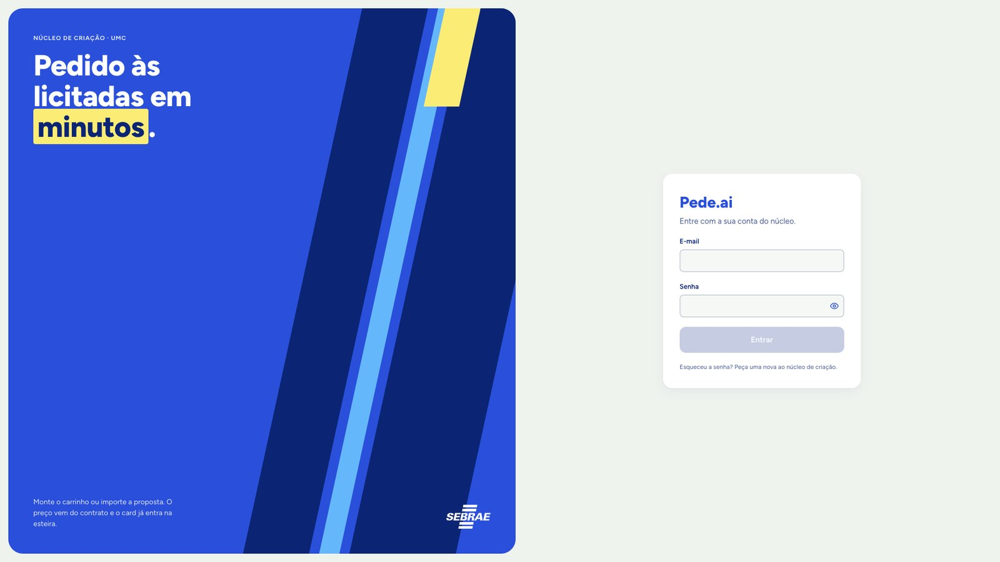
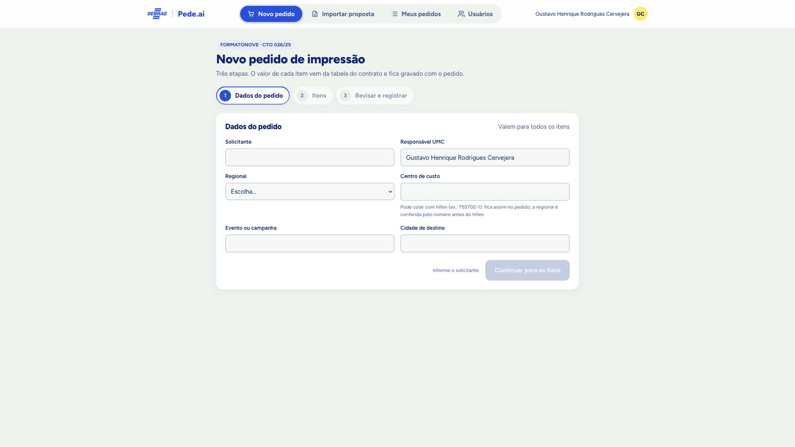
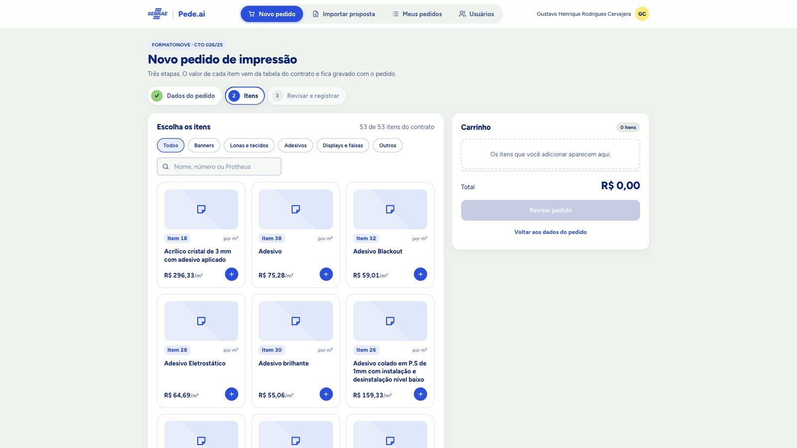
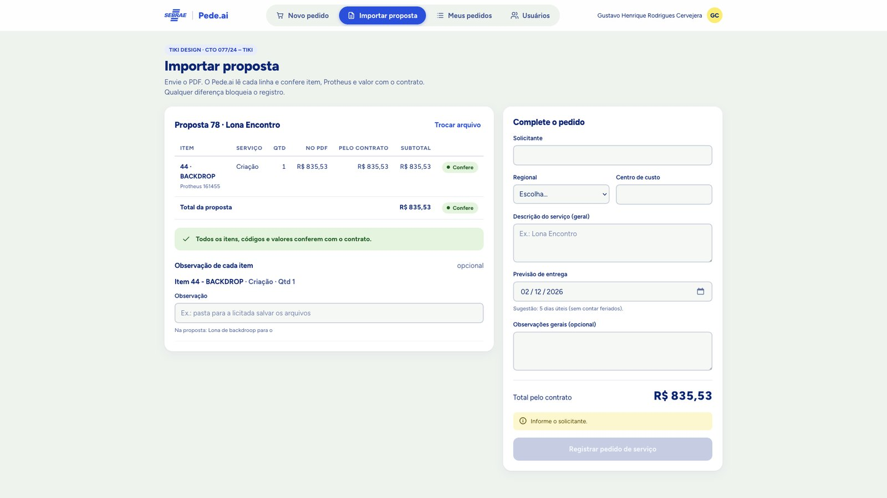
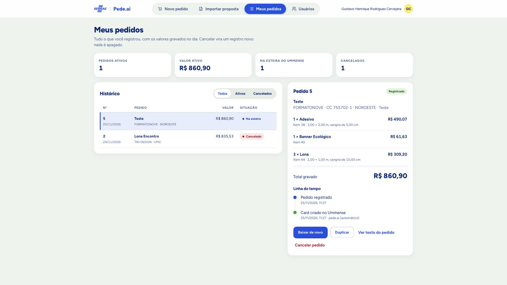
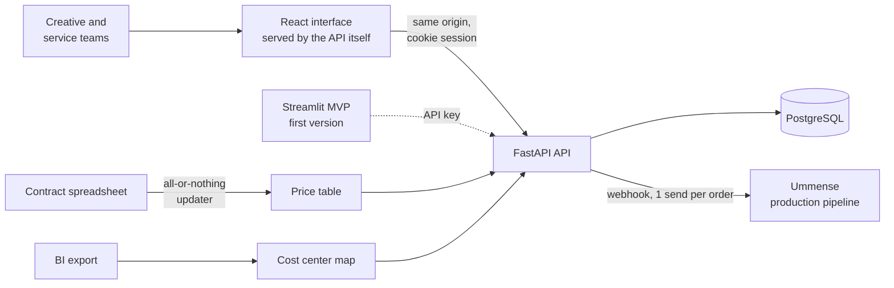

[Português](README.md) · **English**

# Pede.ai

**From a manual process to a system in production.**

An internal platform for Sebrae/PR's creative team to place orders with vendors hired through public tender. You pick the item, enter the measurements and the order comes out ready: contract price calculated by the system, delivery label generated, card created in the production pipeline and everything stored in a database.

> An internal Sebrae/PR tool, so the code is not public. This repository presents the project: context, architecture, decisions and evolution. The screenshots are from the system in use, with personal data covered.

| problem | my role | result |
|---|---|---|
| Ordering from contracted vendors was manual: area and bleed calculated by hand, cost centers mixed up between regional offices, the same data typed three times and no history. | I designed and built the system: business rules in the API, database, tests, the Ummense integration and both interfaces (MVP and final version). | Final React version live since Nov 23, 2026, after 19 releases. 378 automated tests, orders opening in ~1.3 s (previously up to 8 s) and the services flow delivered 3 weeks ahead of schedule. |

**In this document:** [Context](#context) · [How it was](#how-it-was) · [How it solves it](#how-pedeai-solves-it) · [What it does](#what-it-does) · [Screens](#screens) · [Architecture](#architecture) · [Guaranteed rules](#rules-the-system-guarantees) · [Security and data](#security-and-data) · [Quality](#quality) · [Operations](#operations-today) · [Decisions](#decisions-that-guide-the-system) · [Performance](#measure-before-changing) · [Releases](#releases) · [Next phases](#next-phases) · [Stack](#stack)

---

## Context

Sebrae/PR's creative team produces materials for events and regional offices across the state: vinyl prints, banners, displays, stickers and design services. The team doesn't produce them itself: vendors hired through public tender do. Each one has a contract with a table of items, a Protheus code and a fixed price, per m² or per unit. Every order comes from that contract spreadsheet and goes into the production pipeline in Ummense.

## How it was

To order a vinyl print, you had to:

1. open the contract spreadsheet and find the item;
2. do the math by hand: width and height, plus bleed on each side, times quantity, times the price per m²;
3. type up the order, the delivery label and the Ummense card;
4. check that the cost center really belonged to the regional office asking, in a map of more than 3,000 cost centers.

Design services were worse: the studio sent a quote as a PDF, and someone checked it line by line against the contract.

**The pain**

- **Math errors:** a per-m² item with bleed has five steps, and each one is a chance to get the invoiced amount wrong.
- **Wrong cost center:** one office's expense landed in another office's budget, and nobody noticed at the time.
- **Rework:** the same data was typed three times, in the order, the label and Ummense.
- **No history:** the order only existed as the file that was sent. Repeating an order meant starting from scratch.

## How Pede.ai solves it

| pain | answer |
|---|---|
| math errors | the server calculates from the contract; users only enter measurements and quantity |
| wrong cost center | an immediate warning saying which regional office the cost center belongs to; you only continue by confirming, and that is recorded |
| rework | one form produces the order and the label, and the card goes into the Ummense pipeline on its own |
| no history | every order is in the database: download again, duplicate, cancel |
| PDF quotes | the system reads the PDF and checks every line against the contract; if anything differs, the entry is blocked |

## What it does

- **Print orders:** in 3 steps (details, items, review and submit). A catalog of the contract's items, with category filters and search. For per-m² items, bleed is optional, with a single margin or one per side. Each item can ship to a different destination, and the label comes out with one block per destination.
- **Service orders:** the PDF quote is read and checked item by item (code, price, subtotal and total) against the contract. Tested with 8 real quotes in two layouts: 22 of 22 lines and 8 of 8 totals read correctly.
- **Production pipeline:** once a print order is saved, the card is created in Ummense on its own, with the order in the description and the cost center tag.
- **My orders:** history with the amounts saved on the day, a timeline for each order, re-downloading files, duplicating and cancelling.
- **Users:** individual logins. The administrator creates accounts, issues new passwords, deactivates and reactivates them.

## Screens

| | |
|---|---|
|  **Sign in:** everyone with their own account |  **New order, step 1:** the details apply to every item |
|  **Step 2:** contract catalog with the cart alongside |  **Import quote:** every line checked against the contract |
|  **My orders:** amounts saved on the day and a timeline | |

The screens are in Portuguese, the language the team uses.

## Architecture

- **API (FastAPI):** holds all the business rules. The interfaces only display and submit.
- **Final interface (React + Vite):** served by the API itself, on the same origin. The browser stores no data.
- **MVP (Streamlit):** the first version, which validated the flow with real users.
- **Database (PostgreSQL):** orders, items, events and users, with rules enforced by the database itself.
- **Business data outside the code:** the price table (generated from the contract spreadsheet), vendor settings and the cost center map (exported from BI) live in versioned data files.
- **Order files** (order, label) are built in memory from what is stored. Nothing is saved to disk on the server.

## Rules the system guarantees

- **The price never comes from the user.** The interface sends item and measurements; the server recalculates from the contract table and stores a snapshot of each item. If the table changes tomorrow, today's order stays correct.
- **Money without rounding errors.** All math is in `Decimal`, with commercial rounding only on the item total.
- **Separate formulas by type:** per m², `area with bleed × quantity × price per m²`; per unit, `quantity × price`. One is never applied in place of the other.
- **Cost center × regional office:** a mismatch requires confirmation, and the confirmation is recorded.
- **Vendors outside their contract period** disappear from the interface, and the API refuses calculations and orders.
- **All-or-nothing price table:** if any tab of the spreadsheet is faulty, nothing is saved.

## Security and data

- **Nothing is deleted.** Orders, items and events are insert-only, enforced by the database. Cancelling records a new event.
- **Least privilege.** The API connects to the database with a user that can only read and insert, and cannot change the schema.
- **No public data routes.** Everything requires a session or the MVP server's key, and the API's automatic documentation is off in production.
- **Protected session.** The token lives in a cookie JavaScript can't read, restricted to the site itself. The API refuses calls from other sites and responds with security headers.
- **Login:** passwords stored with scrypt; after 5 failed attempts, the e-mail is locked for 15 minutes.
- **Administrators** can only be set by a command on the server. Every account event is recorded.
- **Two layers of validation:** at the API's entry and again in the database.
- **No secrets in the repository:** keys and passwords live in the server's environment variables.

## Quality

**378 automated tests in 13 files**, run before every release:

- business rules and the integrity of the data tables;
- database: writes, transactions, idempotency and constraints, on a separate test database (the tests refuse to run against production);
- **stress:** hundreds of random carts checked against an exact calculation done another way, hostile input on every route (never a 500 error) and concurrent writes;
- **end to end:** the real interface against the real API;
- sessions, closed routes, user administration, PDF reading and the Ummense integration (without ever calling the real service).

The stress test found one cent missing on ~0.1% of items (math in `float`); the math moved to `Decimal`.

## Operations today

- **Release in 4 steps:** tests → database change (when there is one, compatible with the previous version) → release → production check without writing anything.
- **Current hosting:** API and interface on a cloud service, and a managed PostgreSQL database, both on free plans.
- **Known limits:** the free server sleeps when idle (the first call is slow); API and database are on different continents, and every query pays that round trip; the database's free plan has no daily backup.

## Decisions that guide the system

1. **Validate before polishing.** The Streamlit MVP went to production first. The day the services flow went live, the service team asked for per-item descriptions and notes, and it shipped the same day. Only after real use was validated did the final React version replace the MVP.
2. **Rules in the backend, simple interface.** All rules live in the API. Swapping the MVP for the final version didn't change a single rule.
3. **The price never comes from the user.** The server recalculates and stores a snapshot of the item.
4. **Nothing is deleted.** History is guaranteed by the database, not by the code's good intentions.
5. **Business data outside the code.** Prices, vendors and the cost center map are data, not constants in the code.
6. **Layered security.** Input validated in the API and again in the database, with least privilege.

## Measure before changing

Opening an order from the history took up to 8 seconds. Measured in production: routes without the database answered in 0.3 s, with the database in 2.7 s, because each new connection cost ~1.2 s just for the security handshake. With a connection pool and session caching, it dropped to ~1.3 s. The test suite went from 274 s to 108 s.

## Releases

19 releases in six months, from the MVP (May 28, 2026) to the final version (v1.0, Nov 23, 2026). Every release is in the **[release log](docs/versoes.md)** (in Portuguese).

| version | date | milestone |
|---|---|---|
| v0.1 | May 28 | MVP live |
| v0.3 | Aug 25 | bleed, per-item destination, 10 bugs fixed |
| v0.5–v0.6 | Oct 2 | insert-only PostgreSQL, API key, restricted database user |
| v0.7 | Oct 6 | individual logins and history |
| v0.10 | Oct 13 | PDF quote reading; services live 3 weeks ahead of schedule |
| v0.12 | Nov 19 | automatic Ummense card |
| **v1.0** | **Nov 23** | **final React version replaces the MVP** |
| v1.1 | Nov 23 | user administration |

## Next phases

**Phase 9: official adoption by Sebrae/PR's IT team**

- Host on Sebrae's infrastructure: API and interface on an internal server and PostgreSQL managed by IT, replacing the free plans.
- This removes today's limits: the sleeping server, the round trip between continents and the lack of daily backups.
- Backup, monitoring and access defined by IT.
- Login with the corporate account, if IT prefers it over the app's own login (to be decided).
- Cost center map pulled straight from BI, replacing the manual export.
- Handover: architecture documentation, release walkthrough and an operations guide.

**Phase 10: product evolution**

- Turn off the Streamlit MVP.
- Failed sends to Ummense recorded, with a "resend" button.
- Ummense card progress shown back in Pede.ai.
- Real photos in the catalog.
- New vendors, which need new pricing rules (by quantity tier, for example).

## Stack

| layer | technology |
|---|---|
| API | Python, FastAPI, Pydantic, slowapi (rate limiting) |
| final interface | React, Vite |
| MVP | Streamlit |
| database | PostgreSQL (insert-only triggers, RLS, CHECKs) |
| tests | pytest |
| integration | Ummense (webhook) |
| PDF reading | pdfplumber, in memory |
| contract spreadsheet | pandas, in the price table updater |

---

Made by **Gustavo Cervejera**, creative team (UMC), Sebrae/PR · [portfolio](https://cervejera.github.io/en/projeto-pede-ai.html) · gcervejera@gmail.com
