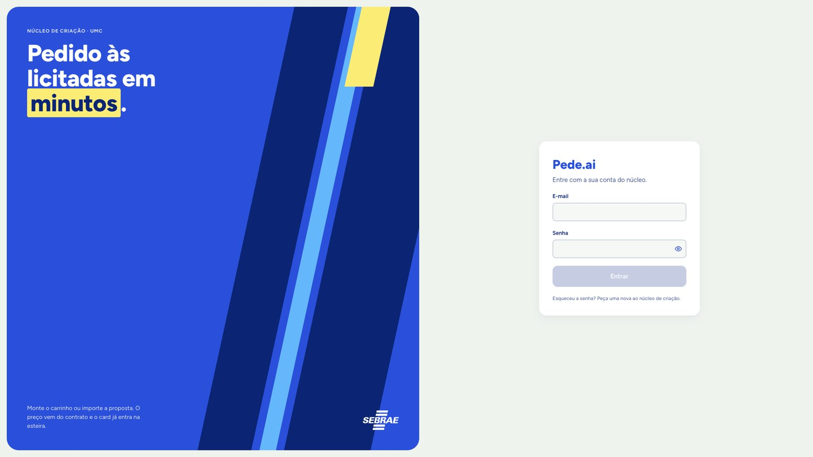
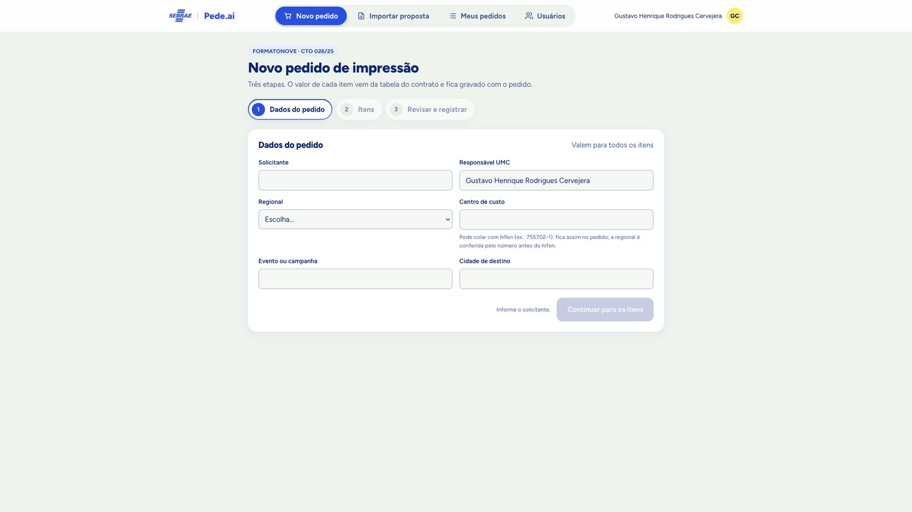
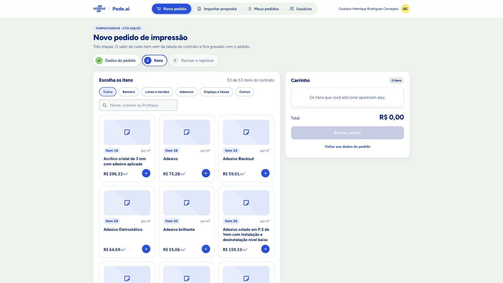
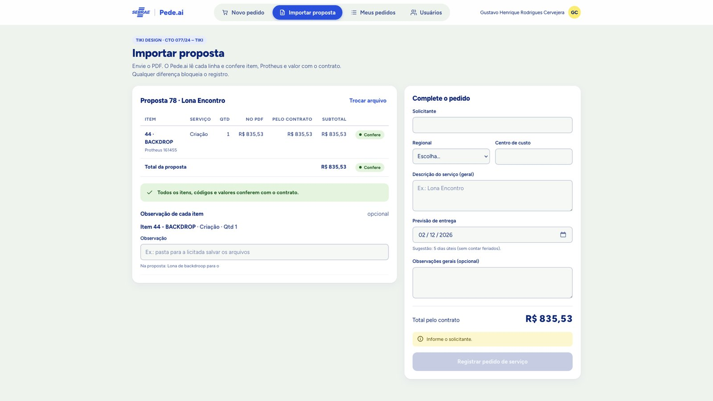
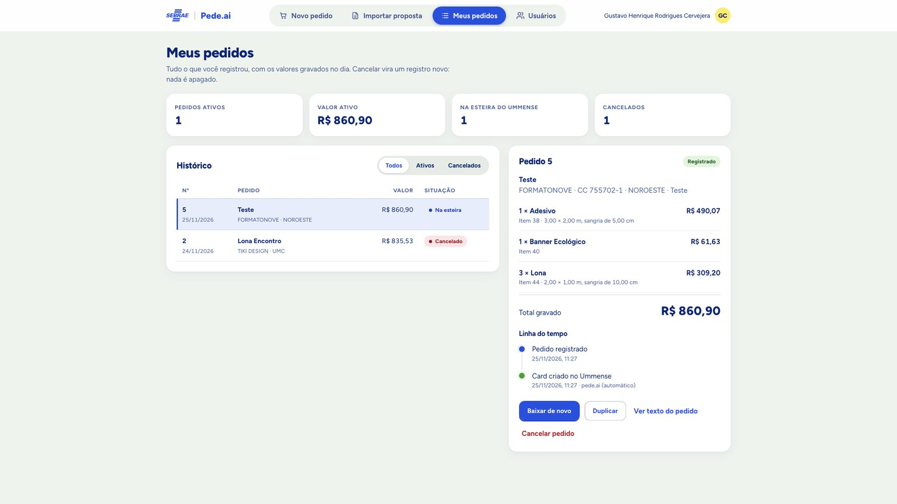
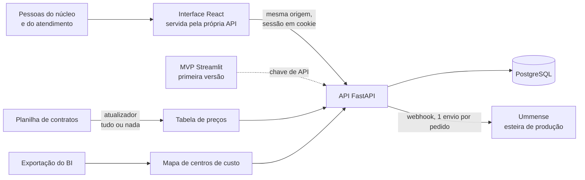

**Português** · [English](README.en.md)

# Pede.ai

**De um processo manual a um sistema em produção.**

Plataforma interna do núcleo de criação do Sebrae/PR para fazer pedidos às empresas contratadas por licitação. A pessoa escolhe o item, informa as medidas e o pedido sai pronto: preço do contrato calculado pelo sistema, etiqueta de entrega gerada, card criado na esteira de produção e tudo guardado num banco.

> Ferramenta interna do Sebrae/PR, por isso o código não é público. Este repositório apresenta o projeto: contexto, arquitetura, decisões e evolução. As telas são do sistema em uso, com dados pessoais cobertos.

| problema | meu papel | resultado |
|---|---|---|
| Pedir material às licitadas era manual: conta de área e sangria na mão, centro de custo trocado entre regionais, o mesmo dado digitado três vezes e nenhum histórico. | Concebi e construí o sistema: regra de negócio na API, banco, testes, integração com o Ummense e as duas interfaces (MVP e versão final). | Versão final em React no ar desde 23/11/2026, depois de 19 versões. 378 testes automatizados, pedido abrindo em ~1,3 s (antes até 8 s) e o fluxo de serviço entregue 3 semanas antes do prazo. |

**Neste documento:** [Contexto](#contexto) · [Como era](#como-era) · [Como resolve](#como-o-pedeai-resolve) · [O que faz](#o-que-ele-faz) · [Telas](#telas) · [Arquitetura](#arquitetura) · [Regras garantidas](#regras-que-o-sistema-garante) · [Segurança e dados](#segurança-e-dados) · [Qualidade](#qualidade) · [Operação](#operação-hoje) · [Decisões](#decisões-que-guiam-o-sistema) · [Desempenho](#medir-antes-de-mexer) · [Versões](#versões) · [Próximas fases](#próximas-fases) · [Stack](#stack)

---

## Contexto

O núcleo de criação do Sebrae/PR produz o material dos eventos e das regionais do estado: lonas, banners, displays, adesivos e serviços de design. Quem produz não é o núcleo, e sim empresas contratadas por licitação. Cada uma tem um contrato com uma tabela de itens, código Protheus e preço fixo, por m² ou por unidade. Todo pedido sai da planilha desse contrato e entra na esteira de produção no Ummense.

## Como era

Para pedir uma lona, a pessoa:

1. abria a planilha do contrato e achava o item;
2. fazia a conta na mão: base e altura, mais a sangria de cada lado, vezes a quantidade, vezes o valor do m²;
3. digitava o pedido, a etiqueta de entrega e o card no Ummense;
4. conferia se o centro de custo era mesmo da regional que pediu, num mapa com mais de 3 mil centros de custo.

No serviço de design era pior: o estúdio mandava uma proposta em PDF, e alguém conferia linha a linha contra o contrato.

**A dor**

- **Erro de conta:** um item por m² com sangria tem cinco etapas, e cada uma é uma chance de errar o valor que vai para a nota.
- **Centro de custo trocado:** a despesa de uma regional caía no orçamento de outra, e ninguém percebia na hora.
- **Retrabalho:** o mesmo dado era digitado três vezes, no pedido, na etiqueta e no Ummense.
- **Nenhum histórico:** o pedido existia só como o arquivo enviado. Repetir um pedido era começar do zero.

## Como o Pede.ai resolve

| dor | resposta |
|---|---|
| erro de conta | o servidor calcula pelo contrato; quem usa só informa medida e quantidade |
| centro de custo trocado | alerta na hora, dizendo de que regional é o CC; só segue quem marca que está ciente, e isso fica registrado |
| retrabalho | um único preenchimento gera o pedido e a etiqueta, e o card entra sozinho na esteira do Ummense |
| sem histórico | todo pedido fica no banco: baixar de novo, duplicar, cancelar |
| proposta em PDF | o sistema lê o PDF e confere cada linha com o contrato; se houver divergência, o registro fica bloqueado |

## O que ele faz

- **Pedido de impressão:** em 3 etapas (dados, itens, revisar e registrar). Vitrine com os itens do contrato, filtro por categoria e busca. Nos itens por m², a sangria é opcional, com margem única ou uma por lado. Cada item pode ir para um destino diferente, e a etiqueta sai com um bloco por destino.
- **Pedido de serviço:** a proposta em PDF é lida e conferida item a item (código, valor, subtotal e total) contra o contrato. Testado com 8 propostas reais, em dois layouts: 22 de 22 linhas e 8 de 8 totais lidos certos.
- **Esteira de produção:** registrado o pedido de impressão, o card é criado sozinho no Ummense, com o pedido na descrição e a tag do centro de custo.
- **Meus pedidos:** histórico com os valores gravados no dia, linha do tempo de cada pedido, baixar os arquivos de novo, duplicar e cancelar.
- **Usuários:** login individual. O administrador cria contas, gera nova senha, desativa e reativa.

## Telas

| | |
|---|---|
|  **Entrar:** cada pessoa com a sua conta |  **Novo pedido, etapa 1:** os dados valem para todos os itens |
|  **Etapa 2:** vitrine do contrato e carrinho ao lado |  **Importar proposta:** cada linha conferida com o contrato |
|  **Meus pedidos:** valores gravados no dia e linha do tempo | |

## Arquitetura

- **API (FastAPI):** concentra toda a regra de negócio. As interfaces só mostram e enviam.
- **Interface final (React + Vite):** servida pela própria API, na mesma origem. O navegador não guarda dado nenhum.
- **MVP (Streamlit):** a primeira versão, que validou o fluxo com usuários reais.
- **Banco (PostgreSQL):** pedidos, itens, eventos e usuários, com regras garantidas pelo próprio banco.
- **Dados de negócio fora do código:** tabela de preços (gerada da planilha de contratos), configuração das licitadas e mapa de centros de custo (exportado do BI) ficam em arquivos de dados versionados.
- **Arquivos do pedido** (pedido, etiqueta) são montados em memória, a partir do que está gravado. Nada é salvo em disco no servidor.

## Regras que o sistema garante

- **O preço nunca vem de quem usa.** A tela manda item e medidas; o servidor recalcula pela tabela do contrato e grava um retrato de cada item. Se a tabela mudar amanhã, o pedido de hoje continua certo.
- **Dinheiro sem erro de arredondamento.** Toda a conta é em `Decimal`, com arredondamento comercial só no total do item.
- **Fórmulas separadas por tipo:** por m², `área com sangria × quantidade × valor do m²`; por unidade, `quantidade × valor`. Uma nunca é aplicada no lugar da outra.
- **Centro de custo × regional:** divergência exige confirmação, e a confirmação fica registrada.
- **Licitada fora da vigência** some da tela, e a API recusa cálculo e pedido.
- **Tabela de preços no "tudo ou nada":** se qualquer aba da planilha vier com defeito, nada é gravado.

## Segurança e dados

- **Nada é apagado.** Pedidos, itens e eventos só aceitam inserção, e quem garante é o banco. Cancelar registra um novo evento.
- **Privilégio mínimo.** A API conecta ao banco com um usuário que só lê e insere, sem poder alterar a estrutura.
- **Nenhuma rota de dado é pública.** Tudo exige sessão ou a chave do servidor do MVP, e a documentação automática da API fica desligada em produção.
- **Sessão protegida.** O token fica num cookie que o JavaScript não lê, restrito ao próprio site. A API não aceita chamadas de outros sites e responde com cabeçalhos de segurança.
- **Login:** senha guardada com scrypt; depois de 5 erros, o e-mail fica travado por 15 minutos.
- **Administrador** só é definido por comando no servidor. Todo evento de conta fica registrado.
- **Validação em duas camadas:** na entrada da API e de novo no banco.
- **Nenhum segredo no repositório:** chaves e senhas ficam nas variáveis de ambiente do servidor.

## Qualidade

**378 testes automatizados em 13 arquivos**, rodando antes de toda publicação:

- regras de negócio e integridade das tabelas de dados;
- banco: gravação, transação, idempotência e restrições, num banco de teste separado (o teste se recusa a rodar contra a produção);
- **estresse:** centenas de carrinhos aleatórios conferidos contra uma conta exata feita de outro jeito, entrada hostil em todas as rotas (nunca erro 500) e gravações simultâneas;
- **ponta a ponta:** a interface de verdade contra a API de verdade;
- sessão, rotas fechadas, administração de usuários, leitura de PDF e integração com o Ummense (sem nunca chamar o serviço real).

O teste de estresse achou um centavo a menos em ~0,1% dos itens (conta em `float`); a conta passou para `Decimal`.

## Operação hoje

- **Publicação em 4 passos:** testes → mudança de banco (quando há, compatível com a versão anterior) → publicação → conferência da produção sem gravar nada.
- **Hospedagem atual:** API e interface num serviço de nuvem e banco PostgreSQL gerenciado, ambos em planos gratuitos.
- **Limites conhecidos:** o servidor gratuito dorme sem uso (a primeira chamada demora); API e banco estão em continentes diferentes, e cada consulta paga essa ida e volta; o plano gratuito do banco não tem backup diário.

## Decisões que guiam o sistema

1. **Validar antes de polir.** O MVP em Streamlit foi para produção primeiro. No dia em que o fluxo de serviço entrou no ar, o atendimento pediu descrição e observação por item, e saiu no mesmo dia. Só depois de validado o uso real, a versão final em React substituiu o MVP.
2. **Regra no backend, tela simples.** Toda a regra fica na API. A troca do MVP pela versão final não mudou nenhuma regra.
3. **O preço nunca vem de quem usa.** O servidor recalcula e grava um retrato do item.
4. **Nada é apagado.** O histórico é garantido pelo banco, não pela boa vontade do código.
5. **Dado de negócio fora do código.** Preço, licitadas e mapa de centros de custo são dados, não constantes no código.
6. **Segurança em camadas.** Entrada validada na API e de novo no banco, com privilégio mínimo.

## Medir antes de mexer

Abrir um pedido no histórico levava até 8 segundos. Medido em produção: rotas sem banco respondiam em 0,3 s, com banco em 2,7 s, porque cada conexão nova custava ~1,2 s só para negociar segurança. Com pool de conexões e cache na sessão, caiu para ~1,3 s. A suíte de testes caiu de 274 s para 108 s.

## Versões

19 versões em seis meses, do MVP (28/05/2026) à versão final (v1.0, 23/11/2026). Cada publicação está no **[registro de versões](docs/versoes.md)**.

| versão | data | marco |
|---|---|---|
| v0.1 | 28/05 | MVP no ar |
| v0.3 | 25/08 | sangria, destino por item, 10 bugs corrigidos |
| v0.5–v0.6 | 02/10 | PostgreSQL só de inserção, chave de API, usuário de banco restrito |
| v0.7 | 06/10 | login individual e histórico |
| v0.10 | 13/10 | leitura da proposta em PDF; serviço no ar 3 semanas antes do prazo |
| v0.12 | 19/11 | card automático no Ummense |
| **v1.0** | **23/11** | **versão final em React substitui o MVP** |
| v1.1 | 23/11 | administração de usuários |

## Próximas fases

**Fase 9: adoção oficial pelo T.I. do Sebrae/PR**

- Hospedar na infraestrutura do Sebrae: API e interface num servidor interno e o PostgreSQL gerido pelo T.I., no lugar dos planos gratuitos.
- Isso resolve os limites de hoje: o servidor que dorme, a ida e volta entre continentes e a falta de backup diário.
- Backup, monitoramento e acesso definidos pelo T.I.
- Login integrado à conta corporativa, se o T.I. preferir no lugar do login próprio (a definir).
- Mapa de centros de custo puxado direto do BI, no lugar da exportação manual.
- Repasse: documentação de arquitetura, passo a passo de publicação e guia de operação.

**Fase 10: evolução do produto**

- Desligar o MVP em Streamlit.
- Falha de envio ao Ummense registrada, com botão "reenviar".
- Andamento do card do Ummense de volta no Pede.ai.
- Fotos reais na vitrine.
- Novas licitadas, que pedem regras de preço novas (por faixa de quantidade, por exemplo).

## Stack

| camada | tecnologia |
|---|---|
| API | Python, FastAPI, Pydantic, slowapi (limite de requisições) |
| interface final | React, Vite |
| MVP | Streamlit |
| banco | PostgreSQL (gatilhos de só inserção, RLS, CHECKs) |
| testes | pytest |
| integração | Ummense (webhook) |
| leitura de PDF | pdfplumber, em memória |
| planilha de contratos | pandas, no atualizador da tabela de preços |

---

Feito por **Gustavo Cervejera**, núcleo de criação (UMC), Sebrae/PR · [portfólio](https://cervejera.github.io/projeto-pede-ai.html) · gcervejera@gmail.com
